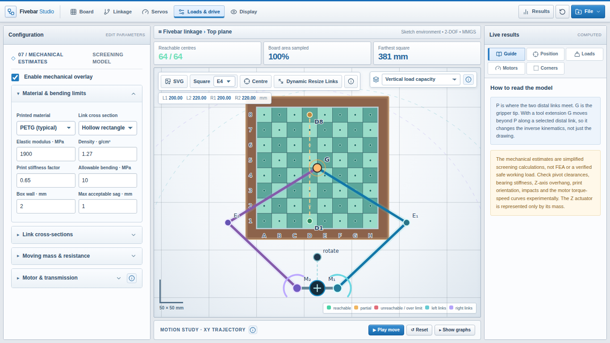

# Fivebar Linkage Studio

I started building a chess robot using a five-bar linkage and quickly realized I needed a way to play with the geometry before printing everything. So I made this simulator to see what reaches, what doesn't, and whether the motors and links I have in mind are even reasonable.

It's built around a chessboard, but the linkage itself can be positioned anywhere, resized, and tested with different tools. It's still an experimental engineering tool, not a substitute for testing a real mechanism.

**[Try the simulator](https://tricko3d.github.io/fivebar-linkage-studio/)** · [Example configuration](examples/255mm-board-2to1.json)

## What you can play with

- **Board dimensions:** Set the playing area and the outer board size independently, including the padding.
- **Linkage geometry:** Four separate link lengths, motor spacing, base position and rotation. You can also drag the linkage and use the interactive resize mode, use the perimeter mounting selector, and check the dimensioned scale square.
- **Gripper placement:** Put the tool at the common joint, extend it past a link, or give it a custom offset.
- **Reachability:** See which chess squares are reachable, inspect the full board with a heatmap, and check elbow configurations and singularities.
- **Servo travel:** Find out whether your geometry fits inside a 180° servo's range, including some margin at the ends.
- **Mechanical estimates:** Compare link material, section dimensions, approximate sag, bending stress, tool weight and motor torque.
- **Transmission:** Try direct drive, 2:1, 3:1 or your own gear ratio, and compare estimated torque and RPM.
- **Movement test:** Animate a queen's path across the board while watching the estimated motor torque and speed graphs.
- **Exports:** Import/save JSON configurations, export the canvas as SVG, generate a detailed Markdown calculation audit, and export a SolidWorks-compatible TXT file of named global variables.

### Mechanical estimates

## Running it

It's a plain HTML, CSS and JavaScript app. No framework, npm install or build step. For local development, run `python3 -m http.server 8000` in the repo folder, then open `http://localhost:8000`. You can also just use the live GitHub Pages site.

The live site is published from the `main` branch using GitHub Pages.

### How the code is organized

- [`index.html`](index.html): the markup and entry points.
- [`css/styles.css`](css/styles.css), [`css/cad-theme.css`](css/cad-theme.css), [`css/toolbar.css`](css/toolbar.css) and [`css/studio-polish.css`](css/studio-polish.css): layouts and CAD styling.
- [`js/state.js`](js/state.js): defaults, shared state and geometry helpers.
- [`js/kinematics.js`](js/kinematics.js): the five-bar calculations and elbow branches.
- [`js/mechanics.js`](js/mechanics.js): bending, sag, loads and motor estimates.
- [`js/coverage.js`](js/coverage.js): square coverage and servo range checks.
- [`js/render.js`](js/render.js): the SVG board and linkage drawing.
- [`js/movement.js`](js/movement.js): the queen move simulation and graphs.
- [`js/controls.js`](js/controls.js): settings, configuration import/export and reset.
- [`js/reports.js`](js/reports.js): Markdown audit and SolidWorks variables exports.
- [`js/bootstrap.js`](js/bootstrap.js): pointer interaction and initialization.
- [`js/layout.js`](js/layout.js): mobile panels and tab navigation.
- [`js/studio-ui.js`](js/studio-ui.js): scale square, mount selection feedback and contextual tooltips.

The scripts run in order and share the simulator's state. Everything stays in vanilla JavaScript so I can work on a single part without digging through a massive HTML file.

My example settings are in [`examples/255mm-board-2to1.json`](examples/255mm-board-2to1.json): a 255 × 255 mm playing area, a 300 × 300 mm outer board, hollow PETG links and an assumed 2:1 reduction. They are test values, not proven specifications.

## About the numbers

The geometry calculations are useful for comparing different layouts, but a reachable position doesn't automatically mean the mechanism will work well there. Real parts can collide, bend, twist and develop play at the pivots.

The mechanical analysis is deliberately approximate. It uses simplified beam bending and motor-load calculations, **not** a full multibody dynamics simulation, verified motor torque curves or FEA. The estimated safety factors are only as good as the assumptions entered. I added the detailed Markdown report so I can check the intermediate numbers and eventually compare them with actual measurements from printed prototypes.

This is a work in progress. The idea is to keep improving the model as I build and test the robot.

## License

I haven't selected a license for this repository yet. Public visibility doesn't automatically give permission to redistribute the code. The upstream reference is MIT-licensed, and its notice is preserved in [`THIRD_PARTY_NOTICES.md`](THIRD_PARTY_NOTICES.md).

---

Built using **ChatGPT (GPT-6, OpenAI)**. The code and kinematic ideas in [**unswei/fivebar**](https://github.com/unswei/fivebar) by Oliver Obst (UNSW) were used as a reference. This is my own chess-focused simulator, not an official fork or release of that project.