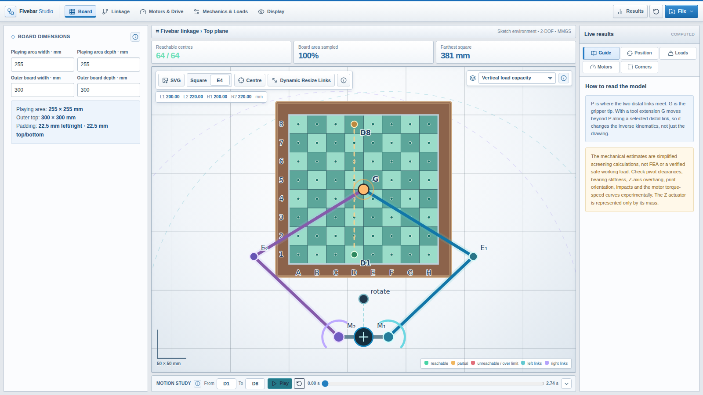

# Fivebar Linkage Studio

I started building a chess robot using a five-bar linkage and wanted a way to experiment with the geometry before printing everything. This simulator lets me explore reachability, motor placement, link lengths, and movement around a chessboard.

**[Try the simulator](https://tricko3d.github.io/fivebar-linkage-studio/)**



## Features

- Adjustable chessboard dimensions and motor mounting positions.
- Independent linkage lengths, assembly branches, and gripper attachments.
- Reachability visualization and servo travel estimates.
- Compact manufacturing/material picker: FDM, SLS, SLA and CNC.
- 15 curated material choices (3–5 per process), with Custom values and preserved legacy material properties.
- Automatic modulus, density, effective stiffness and bending-threshold inputs; manual editing switches to Custom.
- Link materials, cross-sections, loads, motor and transmission settings.
- Motion Study with playback, torque/RPM bars, and selectable graphs.
- Unified Files & Export workspace: JSON import via paste or file, preview and copy/save JSON, SolidWorks TXT, Markdown calculation audits and workspace SVG.

### Files & Export

Use **Files & Export** in the header. The dialog stays a consistent size while you switch among these file views:

- **Configuration (JSON):** Inspect, copy, or save current settings. Select **Import / paste** to paste JSON and apply it, or choose **Load JSON file**. Loading and pasting use the same validation and migration path.
- **SolidWorks variables (TXT):** Preview, copy, or save Tools → Equations compatible variable declarations.
- **Calculation report (MD):** Switch between a formatted Markdown preview and source text; copy or save the original Markdown.
- **Workspace drawing (SVG):** View the exportable vector drawing; copy its SVG markup or save the file.

The former header **Results** toggle has been removed. To access live results on narrow screens, use **View results** inside Files & Export; on desktop, the existing results rail stays available.

## Running locally

Plain HTML, CSS, and JavaScript. Use the **Live Server** extension in VS Code, or run:

```bash
python3 -m http.server 8000
```

Then open http://localhost:8000.

## About the model

The geometry calculations are useful for comparing different layouts, but a reachable position doesn't automatically mean the mechanism will work well there.

I added the detailed Markdown report so I can check the intermediate numbers and eventually compare them with actual measurements from printed prototypes.

### Manufacturing/material picker

Open **Mechanics & Loads → Material & bending limits**, then click the manufacturing/material selector. Choose FDM, SLS, SLA or CNC, then select one of 3–5 materials (or Custom values). The picker overlays the simulator, so the narrow settings panel does not clip the catalog. Escape or clicking outside closes it without changes.

Manufacturing process and material are both saved in the JSON configuration. The selected process is also included in the calculation report and SolidWorks TXT export. Existing PLA/PETG material IDs are preserved. **Custom values** keeps the current modulus, density, stiffness factor and bending limit while assigning a manufacturing process.

Material properties depend on manufacturing route. The SLA picker uses **actual named Formlabs resins**, with representative post-cured *tensile modulus* values: [Tough 2000 Resin V2](https://formlabs.com/eu/products/tough-2000-resin/) (1.8 GPa), [Rigid 4000 Resin](https://formlabs.com/eu/products/rigid-4000-resin/) (4.1 GPa), and [High Temp Resin](https://formlabs.com/eu/products/high-temp-resin/) (2.8 GPa). **Density inputs are approximate**, and the allowable bending stress / stiffness factor are deliberately simplified screening assumptions rather than manufacturer-certified properties. High Temp Resin is primarily heat-resistant, not intended for heavily loaded mechanical parts. Confirm the datasheet, resin formulation, curing schedule, and printer compatibility before designing with these values.

CNC choices are Aluminum 6061-T6, Aluminum 7075-T6, Steel 1018 and Stainless Steel 304. Titanium and POM are no longer selectable. Older saved selections that are no longer in the curated menu become Custom while retaining their numeric material parameters. The dialog's process choices do not verify machine compatibility.

### Material preset limitations

The material picker contains **indicative, room-temperature screening values** for simplified beam calculations. The elastic/bending modulus is a nominal representative value, while *effective stiffness factor* discounts it (especially for printed links). *Allowable bending* is a conservative adjustable screening threshold; **it is not a guaranteed failure stress or design allowable**. Choosing metal assumes a homogeneous solid material; G10/FR-4 and carbon-filled polymers are direction-dependent. Real part strength depends on orientation, annealing, layer adhesion, moisture, temperature, density of infill, and many other variables. TPU in particular is not well modeled by a linear small-deflection beam approximation.

These presets are **not printer compatibility profiles**. High-temperature grades such as PEEK, PEI and PPS-CF may require industrial hardware. Confirm nozzle/chamber requirements against your printer and filament datasheets.

Useful material data and context:

- [Bambu Lab filament guide](https://cdn1.bambulab.com/filament/filament-guide/250123/filament-guide-en.pdf) and individual filament property tables
- [Bambu Lab PLA-CF](https://us.store.bambulab.com/products/pla-cf?id=41158283591816), [PA6-CF](https://eu.store.bambulab.com/nl-nl/products/pa6-cf), [PET-CF](https://us.store.bambulab.com/en/products/pet-cf), [PPS-CF](https://us.store.bambulab.com/collections/bambu-lab-3d-printer-filament/products/pps-cf)
- [Prusa advanced filament guide](https://blog.prusa3d.com/advanced-filament-guide_39718/) and [engineering alloy properties](https://manufacturingprocesses.org/charts/material-properties)

**This was built using ChatGPT (GPT-6, OpenAI) and is not in any way an accurate model.**

Inspired by [unswei/fivebar](https://github.com/unswei/fivebar) by Oliver Obst.

## License

MIT. See [LICENSE](LICENSE).
